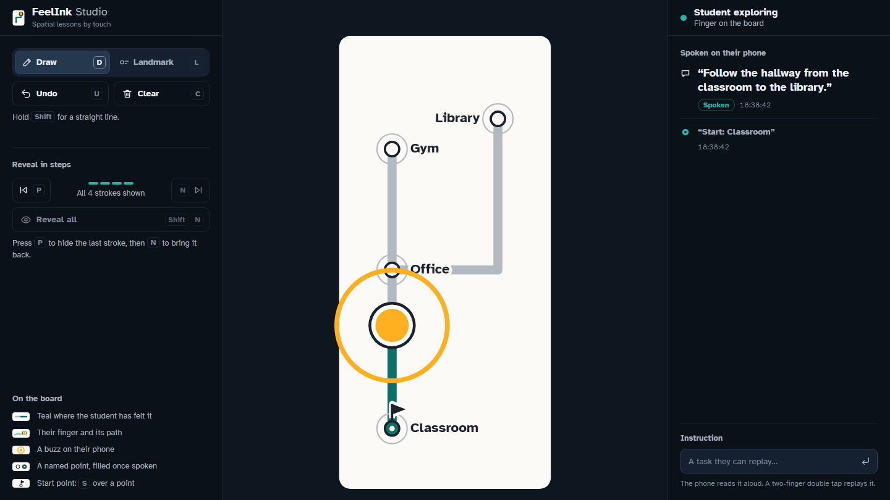
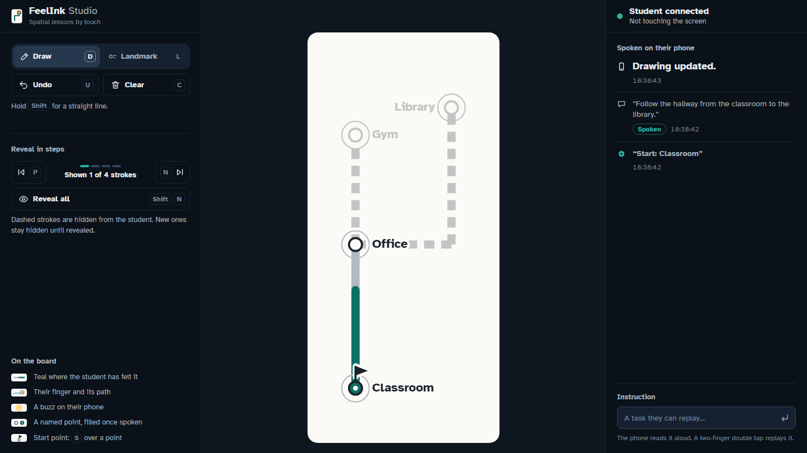
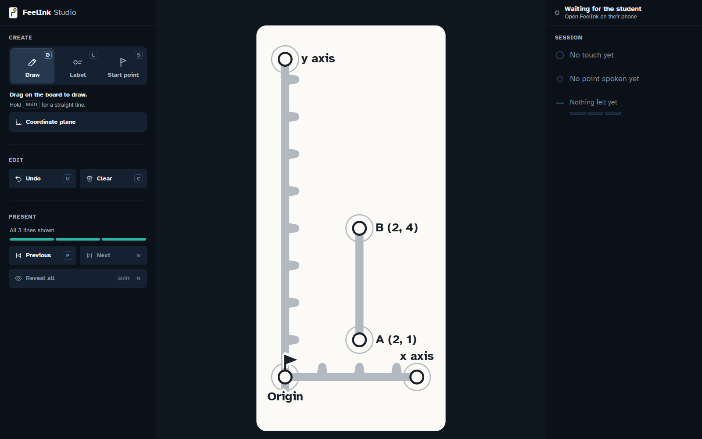
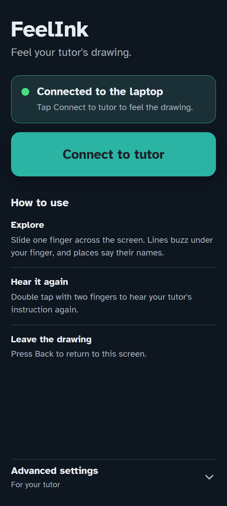
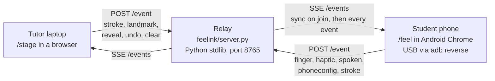

# FeelInk

**A sighted tutor draws on a laptop. A blind student feels the drawing as vibration on an ordinary Android phone and hears its labels spoken aloud.**
Diagrams, routes and maps drawn during a lesson usually need time, materials or preparation before a blind student can explore them by touch. FeelInk is a prototype that tries to close that gap live, with hardware people already own.

[](https://github.com/reeve25/capital-hacks-5/actions/workflows/ci.yml)
Built in a weekend at Capital Hacks 5.0 (Sac State, Nov 6-8, 2026) by Reeve and Nathan. **Status:** working prototype, tested end to end on one Pixel 8 over USB. It has not been tried by a blind student or a teacher yet.

## The problem

A teacher sketches a route, a graph or a circuit on the board. Sighted students see it at once. A blind student gets a verbal description, or waits until someone prepares a tactile graphic. And when the teacher changes the drawing mid-lesson, the student has to wait all over again. Dedicated refreshable tactile displays exist, but they are expensive: APH's Monarch lists at $15,500.

FeelInk is meant as a **supplementary channel**. It does not replace tactile graphics, braille, orientation and mobility instruction or dedicated hardware, and it is **not a navigation app**: no location, no obstacles, and it is never safe for real navigation. The first demonstration is route learning (a classroom-to-library route with named landmarks). The same pieces (lines, labels spoken by name, a start point, step-by-step reveal) are meant for diagrams, graphs and circuits too. A one-click coordinate plane is the first of those on the stage.

## How a lesson goes

The tutor controls the lesson. The student controls their own exploration.

1. **Tutor:** opens the FeelInk Studio page (`/stage`) on a laptop and draws freehand (hold Shift for a straight line). `L` then a click places a named label, and `S` over a label makes it the start point. **Coordinate plane** lays out axes with unit ticks in one click.
2. **Student:** opens `/feel` in Chrome on an Android phone and taps **Connect**. The screen goes black and the whole board (56 x 120 mm) maps onto it at true scale, by our calculation from the screen's specs.
3. **Student:** slides one finger across the glass. The whole phone buzzes while the finger is on a line, fainter toward the edge of the line. Corners and line ends have their own short cues. On a label the phone gives a distinct triple pulse and says its name ("Start: Classroom").
4. **Tutor:** talks to the student, as in any lesson, and watches the stage's student panel: their finger, the last label spoken and how much of the drawing they have felt. (Labels are `landmark` events in the protocol.)
5. **Tutor:** can reveal the drawing one stroke at a time (`N` next, `P` previous, `Shift+N` all). Hidden strokes are dashed for the tutor and silent on the phone, which says at once what each step changed ("Line added.", "Line removed."). Any other edit is said the same way once the tutor pauses for 1.5 s ("Line and label added.", "Label removed.", "Drawing cleared."), never naming a label: the student finds the name.
6. **Both:** the stage shows the student's finger live, teal where their finger has already covered the ink, and an amber ring for each buzz the phone asked for. Android **Back** takes the student out of the drawing.

## Screenshots

| Tutor stage, mid-lesson | Step-through reveal | Coordinate plane | Student phone, home |
|---|---|---|---|
|  |  |  |  |
| A route from Classroom (the start point) to Library in four lines. The finger is partway up the first line, teal where felt, with an amber buzz ring; "Start: Classroom" was spoken. Simulated phone events on a test relay. | The same route after `P` three times: one line shown, three dashed and hidden from the student, and the history open at "Drawing updated." ×3. Simulated phone events on a test relay. | A second demonstration: the Coordinate plane button, points A (2, 1) and B (2, 4) placed as spoken labels, and a Shift line between them. No phone connected; not yet felt on the Pixel. | The phone's home screen, connected to the laptop. |

The three stage pictures are headless Chrome renders (1600 x 1000) of the stage on `main` at `bbec5eb`, run against a test relay, not the demo one. **No phone was connected for any of them.** For the first two, a script posted the route to the test relay and also posted every phone-side event (presence, finger, buzzes, spoken lines), so the connected state is simulated, not a real Pixel session. The coordinate plane was made with the stage's own button, Label tool and Shift line, driven through Chrome's DevTools protocol. The phone home picture is an earlier headless render, kept as is. Real recorded takes from the Pixel are still to come. On the phone, Live mode is a plain black screen by design, so it is not shown.

## Architecture



- **Relay** (`feelink/server.py`, Python standard library only): serves the pages, keeps the board (strokes, landmarks, the latest instruction, the reveal step) and broadcasts every event to every client over Server-Sent Events. A client that joins late, or reconnects, gets a full `sync` first. One relay per port: it refuses a port another relay already holds.
- **Stage** (`feelink/stage.html` + `feelink/board.js`): the tutor's workspace. `board.js` is pure logic (smoothing, reveal, the spoken log, link state, rings) with no browser calls, so it is unit-tested under Node.
- **Phone** (`feelink/feel.html` + `feelink/tactile.js`): maps the finger to board millimetres and turns geometry into vibration patterns and speech. `tactile.js` is pure logic too (stroke cleaning, corner detection, fade levels, landmark hits).
- No app install, no build step, no third-party code. Board units are millimetres on both ends.

## Run it

Needs Python 3, an Android phone with Chrome and USB debugging on, and `adb` (Android platform-tools).

```bash
python -I feelink/server.py        # relay on port 8765; -I ignores env vars and user site-packages
adb reverse tcp:8765 tcp:8765      # phone on USB: its localhost:8765 now reaches the laptop
```

Then open **http://localhost:8765/stage** on the laptop and **http://localhost:8765/feel** in Chrome on the phone, and tap **Connect to tutor**. A USB replug clears the reverse; `python -I tools/pixel_keepalive.py` re-applies it after every reconnect. `/dev` is the phone page with the practice and test tools shown.

Checks (relay self-test, 37 tactile and 45 stage unit tests, a secret scan; needs Node too): `bash tools/check.sh`. CI runs the same script on every pull request and on `main`.

## Design decisions, and what we measured

Labels: **Measured** = on the real Pixel 8 or by a command; **Built** = in the code, not measured; **Emulated** = headless browser only.

- **Chrome on the Pixel 8 ignores `navigator.vibrate(0)`** (Measured with `adb shell dumpsys vibrator_manager`). The standard stop never cancelled anything: 0 of 132 Chrome vibrations were cancelled, and a 2 s buzz "stopped" with `vibrate(0)` ran for 2091 ms. A new call does replace the running one, so FeelInk stops with a 1 ms buzz, `vibrate(1)`, which ended the same buzz at 311 ms when called at 300 ms.
- **The line is one 5 s hold, re-armed at 4.5 s.** An 800 ms hold re-armed every 600 ms restarted the motor about every 0.6 s (dumpsys) and felt like ringing. A single long hold feels like a steady hum. Android plays buzzes longer than 1 s at the phone's Media vibration intensity: at setting 1 they played at 51% strength, at 3 the 5 s hold played at 100% (Measured). The demo phone stays at 3.
- **Strength is rhythm, because the Web Vibration API has no amplitude.** The strong core of a line is the continuous hold. Beside it, three fade steps use sparser pulses (12/60, 20/35, 30/15 ms on/off) that read as weaker.
- **Core 4 mm, fade 1.5 x core.** The first prototype test ran on a 14 mm core; afterwards Reeve and Nathan judged 1-5 mm to read best. The default core is 4 mm, and the fade follows it at 1.5 x (6 mm each side), so the tutor sets one number in the phone's Advanced settings instead of two.
- **Clean strokes before feeling them.** Hand-drawn strokes are simplified (Ramer-Douglas-Peucker, 2 mm) so wobbles don't read as corners. A corner is a turn of 40 degrees or more over a 5 mm window, measured on the raw stroke so circles get no false corners. A finger moving fast enough to skip over a line between touch samples still gets a 25 ms tick.
- **A label is a state, not a one-off cue.** Earlier cues blended into the line's hum when a label sat on the path. Now, within 4 mm of a label, the hold stops, there are 400 ms of silence while the name starts, then three 220 ms pulses 130 ms apart (the only long triple). While the finger rests there, only a 70 ms heartbeat every 1.2 s plays. The name is not repeated if the finger comes back within 3 s. Reeve, on the Pixel: arrival is clear and spoken.
- **Guide back to the line.** The blind student who answered our outreach (below) pointed out that once a finger slips off the line there is no cue for which way to search. Now, after 600 ms off the ink (past the fade band, on no label), the phone gives one 15 ms tap on a cadence that quickens as the finger nears the closest line, like a Geiger counter: 250 ms between taps at the fade band's outer edge, slowing evenly to 900 ms at 20 mm. Beyond 20 mm it is silent, so an empty board stays quiet and the tutor talks. Any line, fade or label cue stops it, and the tutor can turn it off in Advanced settings. **Built**; Emulated: 19 of 19 checks passed in headless Chrome with a stubbed motor (`node tools/feel_guide_check.mjs`, four runs: held 12 mm off, the gaps were 467-482 ms against 467 expected); not yet felt on the Pixel.
- **Sent is not the same as heard.** The phone reports a `spoken` event from the speech engine's end callback, so the stage logs what the phone finished saying, not what it was asked to say. Measured on the Pixel (tag `demo-1`): a line sent at 17:59:38 was reported spoken at 17:59:41.
- **Step-through reveal, ordered by `seq`.** The relay stamps every stored stroke and landmark with an arrival number. A `sync` lists strokes and landmarks separately, so without `seq` a late-joining phone could not tell whether a landmark came before or after a hidden stroke. `reveal` is a count of tutor strokes; any malformed value means "show everything", the safe default. Undo clamps it and Clear resets it. Emulated: 13 of 13 reveal phases passed; not yet felt on the Pixel.
- **One relay per port.** Windows let three relays bind port 8765 side by side (`SO_REUSEADDR`), which split the clients across different boards during a test (Measured). The relay now binds with `SO_EXCLUSIVEADDRUSE` on Windows and exits with an error if the port is taken.

**Earlier end-to-end run** (Measured, Pixel 8 over USB, an earlier build of the stage, Sat Nov 7): 151 of 151 stroke updates reached the phone, relay to phone median 4-5 ms; 192 of 192 finger samples came back to the stage, median 14 ms; corner cues 10 of 10; board mapping error 0.03-0.04 mm. The first buzz of each touch reached Android 93-196 ms after the page asked (later ones 2-13 ms); the cause is not known.

## What we have shown, and what we have not

1. **Device and engineering behaviour, Measured** on one Pixel 8: the numbers above, label arrival and speech heard on the phone, recovery after a USB drop.
2. **Prototype usability, one session:** a sighted tester with eyes closed named 4 of 5 shapes, median 49.9 s per shape. This was an older build (14 mm core). It does not validate the current build, route learning or any educational effect.
3. **Feedback from blind students or teachers: one written reply, and it is critical.** A blind student with tactile-graph experience answered our outreach email (Sat, logged anonymously in `USERS.md`): in their view a single vibrating point on flat glass gives no spatial context once the finger slips off, TalkBack intercepts single-finger gestures, and motor latency plus fingertip numbness turn the lesson into chasing a buzz; they suggest audio sonification or low-cost raised-line boards instead. Nobody from the target group has tried FeelInk.
4. **Evidence that FeelInk helps students learn: none.** It is a hypothesis to test, not a result.

## Limitations

- **USB only.** The phone reaches the laptop through `adb reverse`. Venue Wi-Fi and a phone hotspot both failed and we did not find the cause, so a normal classroom setup (phone and laptop on a shared network) is not demonstrated.
- **One phone, one laptop.** Only a Pixel 8 with Chrome has been tested. Other phones have different motors and settings, so the same pattern may feel different.
- **Android Chrome only.** iOS Safari has no Vibration API, so iPhones can't run it.
- **TalkBack is unverified.** Reading the Android sources suggests one-finger exploring may never reach the page with the screen reader on; nobody has tested it. Do not assume FeelInk works with TalkBack.
- **No target-user validation and no evidence of educational effect** (see above).
- **Far lower fidelity than a tactile display:** one fingertip, no raised dots, no braille.
- **Not yet checked on the Pixel:** the Coordinate plane preset, the grouped tutor tools, the label-placement fix, the felt-share row, the guide-back taps and their switch, label names drawn over the finger, the phone's change lines ("Line added.") and their caption on the stage (everything on main after tag `demo-2`). The last build that passed a check on the Pixel is `demo-2` (Connect, route trace with spoken labels, step-through reveal), Sat 20:33.
- **No authentication.** Anyone on the same network can open the pages, so run the relay only while you use it.

## What we'd do next

1. Put it in front of blind students and teachers of the visually impaired, with consent, and find out whether it helps at all before building more.
2. A classroom network path (shared Wi-Fi or a local hotspot) instead of a USB cable, and find out why the venue network failed.
3. Test TalkBack on a real device, and test more Android phones.
4. Lessons beyond routes: graphs, geometry, circuits, built from the same lines, labels and reveal steps.
5. Tell the student where a change is, not only what it was ("Line added.").

## Repository map

| Path | What it is |
|---|---|
| `feelink/server.py` | Relay: pages, events, board state, `--selftest` |
| `feelink/stage.html`, `feelink/board.js` | Tutor stage (FeelInk Studio) and its pure logic |
| `feelink/feel.html`, `feelink/tactile.js` | Student phone page and the haptic geometry |
| `feelink/*.test.cjs` | Node unit tests (`node --test`) |
| `tools/check.sh` | The gate run by the pre-push hook and CI |
| `tools/pixel_keepalive.py` | Re-applies `adb reverse` after every USB reconnect |
| `tools/record/` | Turns a stage capture and an overhead phone video into one side-by-side GIF/MP4; `sim_take.mjs` records a labelled desktop simulation of the route lesson |
| `STATUS.md`, `DECISIONS.md`, `research/`, `.plans/` | Our working notes: current state, decisions, measurements and research |

## AI-assisted development and open source

We set the product direction and made the product calls; AI agents did the implementation work. The organizers ask for this disclosure, and we would give it anyway.

- **Claude Code** (Anthropic), with a Fable 5.1 session as engineering manager and Opus 5.5 agents for implementation, each in its own git worktree with its own tests.
- **Codex** (OpenAI) for independent reviews.
- **impeccable** design skill by Paul Bakaus, Apache 2.0, used for the visual passes. Other agent skills in `.claude/skills/` (MIT) are listed with their licenses in `.claude/skills/SOURCES.md`.
- **Atkinson Hyperlegible** typeface (Braille Institute), loaded from Google Fonts.
- **FFmpeg**, called by `tools/record/` to compose the demo clips (not bundled).

The repository was started on the first day of the event, and the FeelInk code in it was written during the event.

## License

MIT, see [LICENSE](LICENSE). Files vendored under `.claude/skills/` keep their own licenses.
